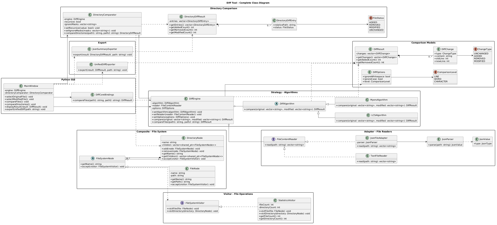
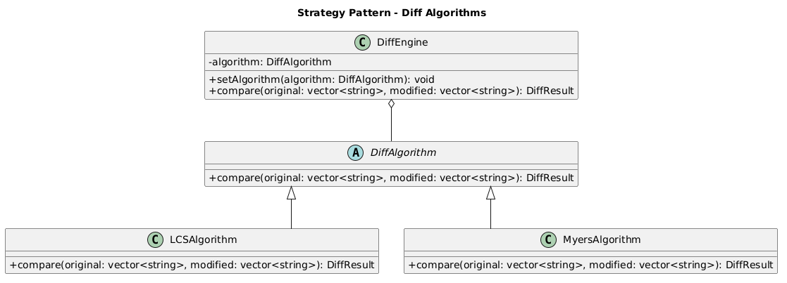
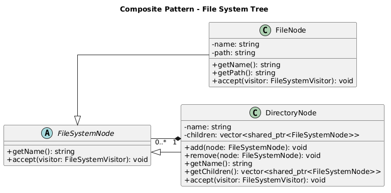
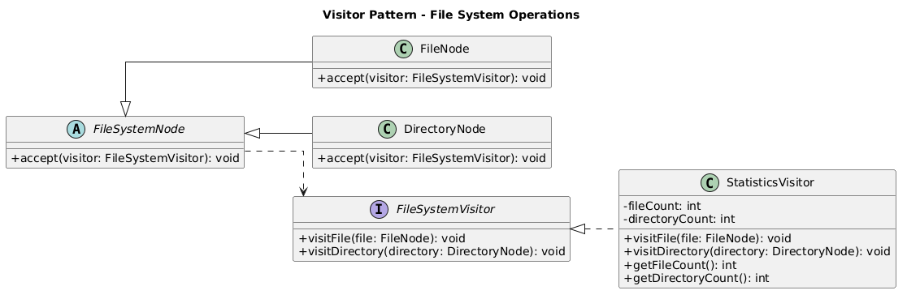
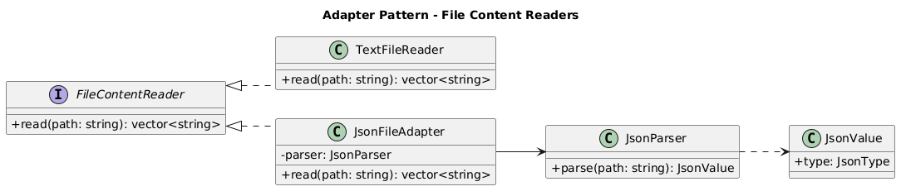

# Diff Tool — інструмент порівняння файлів і каталогів

## Опис проєкту

Diff Tool — це десктопний застосунок для порівняння текстових файлів і каталогів, призначений для пошуку та наочного відображення відмінностей між двома версіями даних.

Програма дозволятиме користувачу вибирати два текстові файли та переглядати їхній вміст поруч із підсвічуванням доданих, видалених і змінених фрагментів. Для порівняння будуть реалізовані два алгоритми — LCS та Myers, між якими користувач зможе перемикатися.

Застосунок підтримуватиме порівняння на рівні рядків, слів і окремих символів. Також буде передбачена можливість ігнорувати відмінності в пробілах і регістрі символів.

Окрім окремих файлів, програма дозволятиме рекурсивно порівнювати два каталоги разом із вкладеними папками. У результаті користувач бачитиме однакові файли, файли зі зміненим вмістом і файли, присутні лише в одному з каталогів. Для файлів із відмінностями можна буде відкрити детальне порівняння тексту.

Результати порівняння можна буде експортувати у форматі unified diff. Графічний інтерфейс забезпечуватиме вибір файлів і каталогів, налаштування параметрів порівняння та зручний перегляд знайдених змін.

На поточному етапі вже створено початкову версію графічного інтерфейсу на Python із використанням бібліотеки PySide6. Подальша розробка передбачає реалізацію алгоритмів на C++ та їх інтеграцію з інтерфейсом.

## Заплановані можливості

- Порівняння двох текстових файлів із підсвічуванням відмінностей.
- Вибір алгоритму порівняння: LCS або Myers.
- Порівняння на рівні рядків, слів і символів.
- Ігнорування пробілів і регістру символів.
- Рекурсивне порівняння каталогів і вкладених папок.
- Визначення однакових, змінених і відсутніх файлів.
- Детальний перегляд відмінностей між файлами.
- Експорт результатів у форматі unified diff.
- Формування JSON-звіту про порівняння каталогів.
- Графічний інтерфейс користувача.

## Огляд аналогів

Перед проєктуванням Diff Tool було розглянуто функціональні можливості наявних програм для порівняння файлів і каталогів. Як основні аналоги обрано WinMerge та Meld.

### WinMerge

**WinMerge** — безкоштовна програма з відкритим вихідним кодом для Windows, призначена для порівняння та об'єднання файлів і каталогів.

Основні можливості:
- Порівняння текстових файлів із відображенням відмінностей.
- Підсвічування змінених фрагментів тексту.
- Порівняння каталогів і вкладених папок.
- Підтримка різних способів відображення змін.
- Можливість об'єднання змін між файлами.

Під час проєктування Diff Tool за основу було взято ідею зручного паралельного відображення двох файлів та візуального виділення відмінностей.

На відміну від WinMerge, наш застосунок також передбачатиме явний вибір між двома алгоритмами порівняння — LCS та Myers, що дозволить досліджувати особливості їхньої роботи.

Офіційний сайт: https://winmerge.org/

### Meld

**Meld** — графічний інструмент порівняння файлів і каталогів, який підтримує візуальний перегляд та об'єднання змін.

Основні можливості:
- Порівняння двох або трьох файлів.
- Підсвічування відмінностей безпосередньо в тексті.
- Порівняння структур каталогів.
- Зручна навігація між знайденими змінами.
- Інструменти для перегляду та об'єднання змінених фрагментів.

Від Meld було запозичено загальний підхід до організації графічного інтерфейсу: одночасний перегляд файлів, зрозуміле виділення змін і можливість швидко переходити між відмінностями.

У Diff Tool ці ідеї планується реалізувати за допомогою Python та PySide6, тоді як алгоритми порівняння працюватимуть у C++.

Офіційний сайт: https://meldmerge.org/

### Порівняння аналогів із запланованим застосунком

| Можливість | WinMerge | Meld | Diff Tool |
|---|---|---|---|
| Порівняння текстових файлів | Так | Так | Заплановано |
| Підсвічування відмінностей | Так | Так | Заплановано |
| Порівняння каталогів | Так | Так | Заплановано |
| Паралельний перегляд файлів | Так | Так | Початковий GUI |
| Навігація між змінами | Так | Так | Заплановано |
| Вибір між LCS та Myers | Не заявлено як стандартну функцію інтерфейсу | Не заявлено як стандартну функцію інтерфейсу | Вибір у GUI створено |
| Експорт unified diff | Залежить від доступних функцій та версії | Залежить від доступних функцій та версії | Заплановано |

### Висновок з огляду аналогів

Аналіз WinMerge та Meld показав, що важливими характеристиками інструментів порівняння є наочність відображення змін, зручна навігація та підтримка каталогів.

У власному застосунку планується поєднати ці підходи з можливістю вибору алгоритму порівняння та модульною архітектурою на основі C++, Python і патернів GoF.

Мета проєкту полягає не в повному відтворенні функціональності наявних програм, а в реалізації власного інструмента з основними можливостями порівняння та зрозумілою об'єктно-орієнтованою архітектурою.

## Архітектура проєкту

Проєкт передбачає розділення логіки порівняння даних і графічного інтерфейсу користувача.

- **C++** — реалізація алгоритмів порівняння, обробка файлів і каталогів, формування результатів.
- **Python** — графічний інтерфейс користувача.
- **PySide6 (Qt for Python)** — бібліотека для створення графічного інтерфейсу.
- **pybind11** — забезпечення взаємодії між C++ і Python.
- **CMake** — налаштування збирання C++ модуля.

Архітектура застосунку проєктується з використанням принципів об'єктно-орієнтованого програмування, SOLID та чотирьох патернів проєктування GoF.

### Загальна UML-діаграма класів



Діаграма відображає заплановану структуру застосунку, основні класи, їхні методи та взаємозв'язки між підсистемами.

## Патерни проєктування GoF

### 1. Strategy (Стратегія)

**Призначення:** забезпечення можливості вибору алгоритму порівняння без зміни логіки основного рушія програми.

У проєкті передбачено абстрактний клас `DiffAlgorithm`, який визначає спільний інтерфейс порівняння. Класи `LCSAlgorithm` та `MyersAlgorithm` реалізовуватимуть відповідні алгоритми.

Клас `DiffEngine` зберігатиме посилання на вибраний алгоритм і викликатиме його через спільний інтерфейс.

**Обґрунтування вибору:** використання Strategy дозволить змінювати алгоритм під час роботи програми, не змінюючи код `DiffEngine`. Також можна буде додавати нові алгоритми без суттєвих змін наявної архітектури.



### 2. Composite (Компонувальник)

**Призначення:** представлення файлів і каталогів у вигляді єдиної деревоподібної структури.

Абстрактний клас `FileSystemNode` визначатиме спільний інтерфейс для елементів файлової системи.

Клас `FileNode` представлятиме окремий файл, а `DirectoryNode` — каталог, який може містити інші файли та вкладені каталоги.

**Обґрунтування вибору:** Composite дозволить однаково працювати з окремими файлами та групами файлів. Це спростить рекурсивний обхід каталогів і організацію порівняння вкладених структур.



### 3. Visitor (Відвідувач)

**Призначення:** виконання додаткових операцій над деревом файлів і каталогів без необхідності додавати кожну операцію безпосередньо до класів файлової системи.

Інтерфейс `FileSystemVisitor` визначатиме методи `visitFile()` та `visitDirectory()`.

Клас `StatisticsVisitor` реалізовуватиме ці методи для підрахунку кількості файлів і каталогів. Вузли файлової системи підтримуватимуть метод `accept()` для приймання відвідувача.

**Обґрунтування вибору:** Visitor відокремлює операції обробки файлового дерева від його структури. Це дозволить додавати нові операції, наприклад збирання статистики, не перевантажуючи класи `FileNode` та `DirectoryNode`.



### 4. Adapter (Адаптер)

**Призначення:** узгодження різних способів читання та обробки файлів зі спільним інтерфейсом програми.

Інтерфейс `FileContentReader` визначатиме метод `read()`, який повертатиме вміст файлу у форматі, придатному для порівняння.

Клас `TextFileReader` використовуватиметься для звичайних текстових файлів.

Клас `JsonFileAdapter` забезпечуватиме взаємодію з `JsonParser` і перетворюватиме результат розбору JSON у формат, який може обробляти рушій порівняння.

**Обґрунтування вибору:** Adapter дозволить інтегрувати компоненти з різними інтерфейсами без зміни основної логіки програми. Це також створює можливість розширення підтримуваних форматів файлів.



## Аналіз факторів ризику

Під час розроблення Diff Tool було визначено основні технічні та організаційні ризики, які можуть вплинути на реалізацію застосунку.

| Ризик | Можливі наслідки | Спосіб зменшення ризику |
|---|---|---|
| Інтеграція C++ і Python | Помилки збирання або несумісність компонентів | Використання pybind11, CMake та окремих інтеграційних тестів |
| Реалізація алгоритмів LCS і Myers | Некоректне визначення відмінностей | Модульні тести на однакових, змінених і порожніх файлах |
| Обробка великих файлів | Значне використання пам'яті та тривалий час порівняння | Вимірювання продуктивності й оптимізація алгоритмів |
| Рекурсивне порівняння каталогів | Помилки обходу вкладених папок або циклічні переходи через посилання | Перевірка шляхів, контроль рекурсії та обробка символічних посилань |
| Розроблення графічного інтерфейсу | Зависання вікна під час тривалого порівняння | Виконання тривалих операцій поза головним потоком GUI |
| Обмежений час розроблення | Неможливість завершити всі додаткові можливості | Пріоритетна реалізація основних функцій, бонусні завдання — після них |

### Основний технічний ризик

Одним із найважливіших ризиків є забезпечення стабільної взаємодії між C++ та Python, оскільки основна логіка програми реалізовуватиметься на C++, а графічний інтерфейс — на Python.

Для зменшення цього ризику було обрано бібліотеку pybind11, налаштовано збирання через CMake та виконано тестовий виклик C++ функції з Python.

Початкова перевірка інтеграції завершилася успішно. Подальші тести будуть необхідні після додавання складніших типів даних і повноцінних алгоритмів порівняння.

## Поточний стан розробки

На поточному етапі виконано:

- Створено структуру проєкту та Git-репозиторій.
- Налаштовано CMake для збирання C++ модуля.
- Налаштовано інтеграцію C++ і Python за допомогою pybind11.
- Успішно перевірено виклик тестової C++ функції з Python.
- Розроблено загальну UML-діаграму класів.
- Підготовлено UML-діаграми чотирьох патернів GoF.
- Проведено попередній огляд аналогів.
- Визначено основні ризики розроблення.
- Створено початкову версію графічного інтерфейсу на Python із використанням PySide6.
- Реалізовано початкову структуру інтерфейсу з вкладками Files і Directories.
- Додано елементи вибору файлів і каталогів, алгоритму порівняння та рівня деталізації.
- Передбачено налаштування параметрів порівняння та рекурсивного обходу каталогів.

### Графічний інтерфейс

Початкова версія графічного інтерфейсу містить:

- Темне оформлення вікна застосунку.
- Вкладку Files для порівняння двох текстових файлів.
- Вкладку Directories для майбутнього порівняння каталогів.
- Області паралельного перегляду текстового вмісту.
- Вибір алгоритму LCS або Myers.
- Вибір рівня порівняння: Lines, Words або Characters.
- Параметри ігнорування пробілів і регістру.
- Налаштування рекурсивного порівняння каталогів.

Наразі інтерфейс є початковою версією застосунку. Основні візуальні компоненти вже створені, однак повноцінне порівняння та підсвічування відмінностей потребують підключення алгоритмів.

### Наступні етапи розробки

1. Реалізувати алгоритм LCS мовою C++.
2. Реалізувати алгоритм Myers мовою C++.
3. Підключити алгоритми до спільного інтерфейсу DiffAlgorithm.
4. Зібрати оновлений C++ модуль за допомогою CMake та pybind11.
5. Інтегрувати функції порівняння з графічним інтерфейсом PySide6.
6. Реалізувати підсвічування відмінностей і статистику змін.
7. Додати рекурсивне порівняння каталогів.
8. Реалізувати експорт unified diff і формування JSON-звіту.
9. Провести тестування застосунку.

## Запуск

### Вимоги

- Python із підтримкою PySide6.
- Бібліотека PySide6 для графічного інтерфейсу.
- C++ компілятор, CMake та pybind11 для збирання й тестування C++ модуля.

### Запуск графічного інтерфейсу

Для встановлення бібліотеки PySide6:

```bash
python -m pip install PySide6
```

Перебуваючи в кореневому каталозі репозиторію, запустити:

```bash
python python/ui/main_window.py
```

Після запуску відкриється головне вікно застосунку з початковими компонентами інтерфейсу.

### Перевірка зв'язку Python і C++

На поточному етапі перевірено збирання C++ модуля `diff_core` та виклик його тестової функції з Python.

Після збирання модуля та налаштування його доступності для Python тест можна запустити командою:

```bash
python tests/test_bindings.py
```

Успішне виконання тесту підтверджує базову працездатність інтеграції Python і C++ через pybind11.

Повноцінні інструкції зі збирання та запуску всього застосунку будуть доповнені після реалізації алгоритмів порівняння.